# QB Pressure Replay — NFL Player Tracking & Performance Analytics

**An interactive NFL Next Gen Stats tracking replay, multi-play pass-rush performance analytics platform, and tracking-grounded Vision-Language Model (VLM) evaluation suite.**


-E34F26?logo=html5&logoColor=white)
-2EA44F?logo=pytest&logoColor=white)

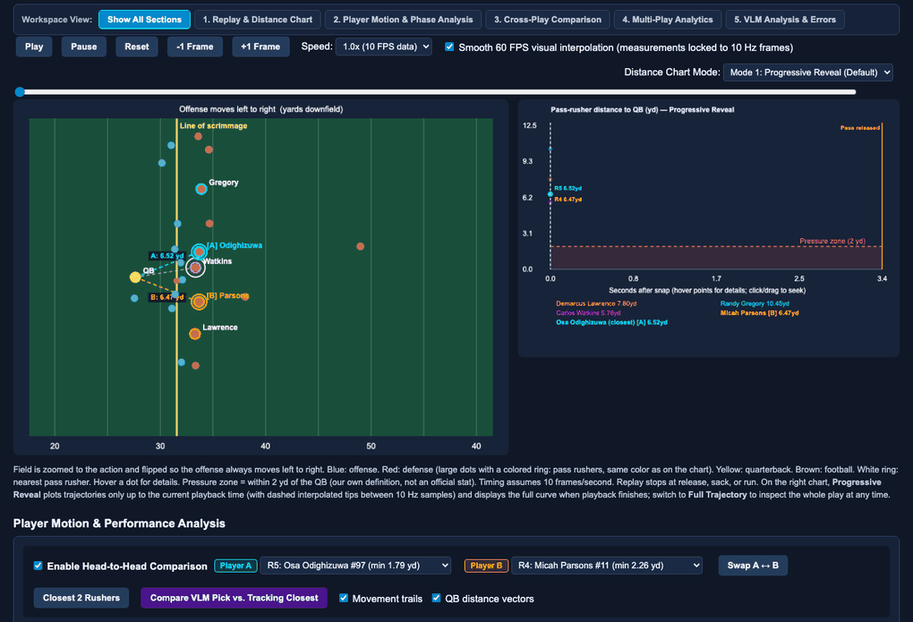

> **Full Video Walkthrough:** A high-resolution H.264 walkthrough recording of the interactive replay, synchronized 5-track player tracking metrics, play-phase decomposition, and cross-game comparison is available in [`docs/assets/demo/qb_pressure_replay_walkthrough.mp4`](docs/assets/demo/qb_pressure_replay_walkthrough.mp4).

---

## Table of Contents

1. [Overview](#1-overview)
2. [Key Features & Visual Tour](#2-key-features--visual-tour)
3. [Technical Architecture](#3-technical-architecture)
4. [VLM Visual Analysis & Tracking-Grounded Evaluation](#4-vlm-visual-analysis--tracking-grounded-evaluation)
5. [Reproducibility & Quick Start](#5-reproducibility--quick-start)
6. [Methodological Scope & Limitations](#6-methodological-scope--limitations)
7. [Repository Structure](#7-repository-structure)
8. [Authorship & Acknowledgments](#8-authorship--acknowledgments)

---

## 1. Overview

Evaluating NFL pass-rush performance from box-score sack totals or binary pressure tags obscures **how**, **when**, and **where** pocket disruption develops. A pass rusher who wins early off the snap may be washed past the pocket, while an interior defender who collapses the pocket late may force an early throw without recording a sack.

**QB Pressure Replay** transforms raw **10 Hz NFL Next Gen Stats player-tracking data** and **Pro Football Focus (PFF) scouting records** into a self-contained, zero-server HTML5 Canvas analytics workbench paired with an offline Python evaluation pipeline:

- **Interactive NFL Field Replay:** Frame-accurate 10 Hz (`0.1s`) pass-play animation from `ball_snap` to pass release, sack, or scramble, with optional **60 FPS display interpolation** for smooth visual motion while keeping all displayed measurements locked to true 10 Hz tracking samples.
- **Pass-Rush Pressure & PFF Alignment:** Compares an application-defined **2.0-yard geometric proximity threshold** against official PFF scouting pressure annotations (`Hit`, `Hurry`, `Sack`) to highlight where geometric proximity and human scouting agree or diverge.
- **Head-to-Head Player Motion Comparison:** Side-by-side kinematic comparison of any two pass rushers (`Player A` in cyan, `Player B` in amber) with historical motion trails, live QB-to-rusher distance vectors, and real-time proximity advantage cards.
- **Synchronized 5-Track Player Tracking Metrics:** A shared timeline plotting QB distance $d(t)$, scalar ground speed $s(t)$, scalar acceleration $a(t)$, relative QB-distance differential $\Delta d(t) = d_A(t) - d_B(t)$, and QB-relative closing rate $-\Delta d/\Delta t$.
- **Play Phase Analysis:** Automatic temporal partitioning of every pass play into **S1: Snap & Initial Burst**, **S2: Pocket Development**, and **S3: Late Rush & Finish** with click-to-seek phase summaries.
- **Cross-Play & Cross-Game Comparison:** Snap-aligned (`t = 0.0s`) comparison of pass rushers across different plays or games using **Line-of-Scrimmage ($\Delta X$) and Snap-QB ($\Delta Y$) spatial normalization** and explicit unequal play-duration handling (`PLAY ENDED` markers without artificial extrapolation).
- **Multi-Play Player Analytics:** Multi-game aggregation with explicit sample denominators, mean and median `[IQR]` QB distance distributions, time-to-closest-approach histograms, and one-click play drill-down.
- **VLM Visual Analysis & Error Evaluation:** Genuine multimodal inference using `Qwen/Qwen2.5-VL-3B-Instruct` on sequential replay frames, audited against independent tracking ground truth across both single-target (`v1`) and temporal trajectory (`v2`) tasks.

---

## 2. Key Features & Visual Tour

### 2.1 Interactive NFL Field Replay & Progressive Distance Chart

The primary replay workspace pairs an oriented NFL field canvas (rotated so the offense always attacks left-to-right across the yellow Line of Scrimmage) with an interactive **Pass-Rusher Distance to QB** chart.

- **Mode 1 — Progressive Reveal (Default):** Plots pass-rusher distance curves progressively up to the current playback time `t` (with dashed interpolated tips during 60 FPS playback) and reveals the full trajectory upon play completion.
- **Mode 2 — Full Trajectory:** Displays full-play distance curves immediately for rapid scrubbing and minimum-distance inspection.

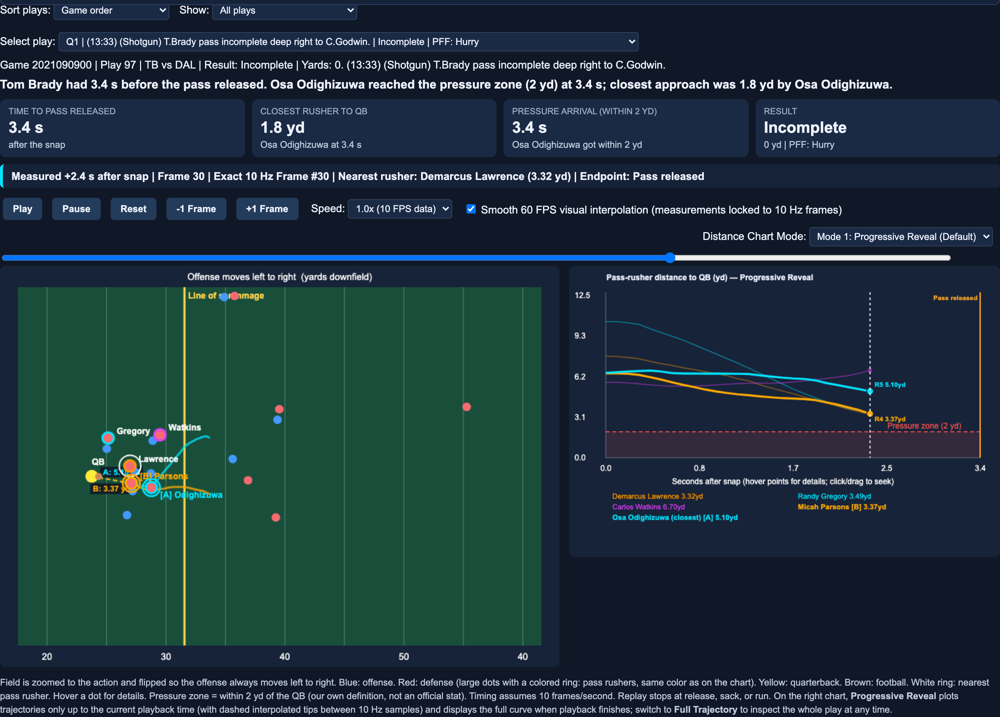

---

### 2.2 Smooth 60 FPS Player Motion & Head-to-Head Comparison

Enabling **Smooth 60 FPS Visual Interpolation** renders sub-frame player positions $(x(t), y(t))$ between consecutive 10 Hz tracking samples while explicitly locking all numeric readouts to the nearest true 10 Hz frame. Users can select any two pass rushers (`Player A` and `Player B`) to render historical motion trails, live QB-to-player distance vectors, and real-time proximity differentials.

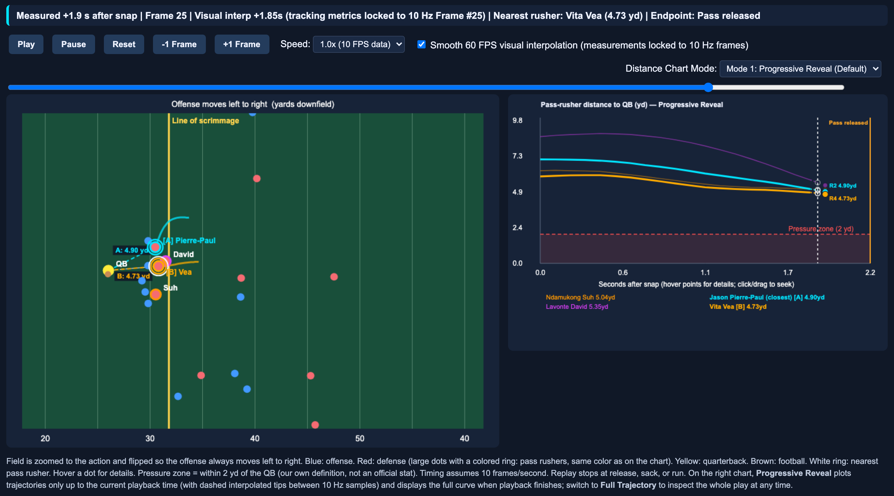

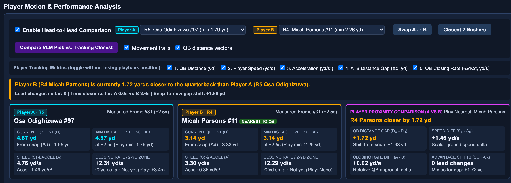

---

### 2.3 Synchronized 5-Track Player Tracking Metrics

Below the live proximity comparison cards, a 5-track synchronized canvas plots continuous physical quantities across the shared snap-aligned timeline (`ball_snap` to play endpoint). Clicking or dragging anywhere on the chart scrubs the main field replay and all analytical panels simultaneously:

1. **QB Distance $d(t)$ (`yd`):** Instantaneous 2D Euclidean separation $\sqrt{(x_r - x_{\text{QB}})^2 + (y_r - y_{\text{QB}})^2}$ relative to the 2.0-yard proximity threshold.
2. **Player Speed $s(t)$ (`yd/s`):** Scalar ground speed along the player's movement vector.
3. **Player Acceleration $a(t)$ (`yd/s²`):** Scalar tracking acceleration magnitude.
4. **Relative QB-Distance Differential $\Delta d(t) = d_A(t) - d_B(t)$ (`yd`):** Signed proximity gap (`< 0` shaded cyan when Player A is closer; `> 0` shaded amber when Player B is closer).
5. **QB-Relative Closing Rate $-\Delta d/\Delta t$ (`yd/s`):** Rate at which QB separation decreases (`> 0` indicates closing on the QB; `< 0` indicates moving away). Distinct from scalar ground speed $s(t)$, as a rusher looping wide around the arc can exhibit high ground speed $s(t)$ with near-zero radial closing rate.

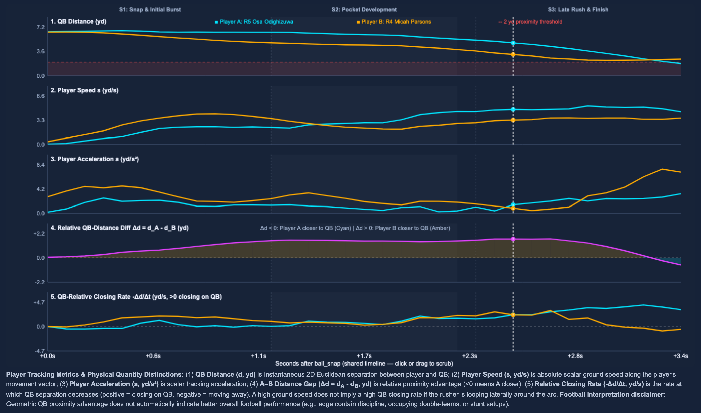

---

### 2.4 Play Phase Analysis (S1 / S2 / S3 Temporal Decomposition)

Every pass play's evaluation window $[t_{\text{snap}}, t_{\text{end}}]$ is partitioned into three interpretable temporal phases:

- **S1: Snap & Initial Burst** (`0% – 33%` of window): Initial get-off, first-step speed, and early separation change.
- **S2: Pocket Development** (`33% – 67%` of window): Pass-rush engagement, counter moves, and pocket compression.
- **S3: Late Rush & Finish** (`67% – 100%` of window): Final pocket collapse, sub-2-yard zone entry, and pass release/sack finish.

Clicking any phase bar or table row jumps the replay directly to the start of that phase.

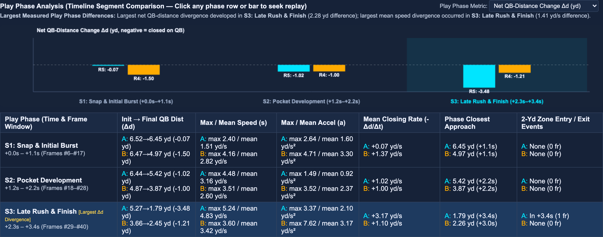

---

### 2.5 Cross-Play & Cross-Game Comparison

The **Cross-Play Comparison** workspace aligns any two pass-rush snaps (`Slot A` and `Slot B`) from the same game or across different games (`Game 2021090900 DAL @ TB` and `Game 2021091200 PHI @ ATL`) on a shared snap-aligned clock (`t = 0.0s` at `ball_snap`):

- **LOS & Snap-QB Spatial Normalization:** Transforms field coordinates into $(\Delta X_{\text{LOS}}, \Delta Y_{\text{QB,snap}})$ so rush paths from different yard lines or offensive directions overlay on a unified tactical grid.
- **Strict Unequal Duration Handling:** Because NFL pass plays vary in duration (e.g., a 2.7s quick completion vs. a 3.4s deep dropback), the shorter play stops at its final observed 10 Hz frame and displays an explicit **`[PLAY ENDED]`** badge. Trajectories are **never extrapolated** beyond observed tracking data.

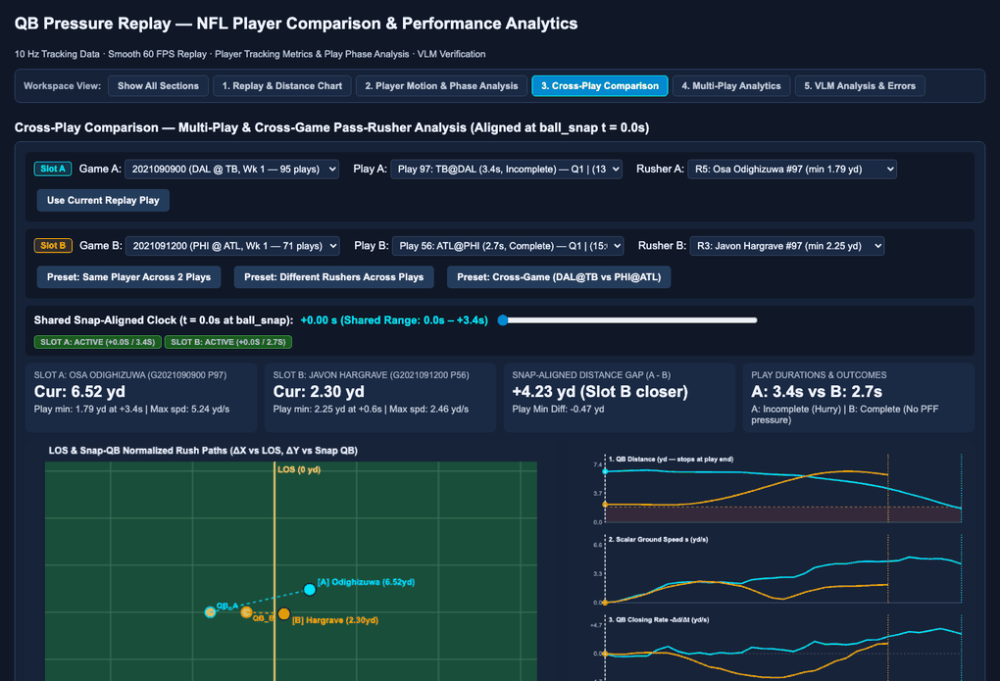

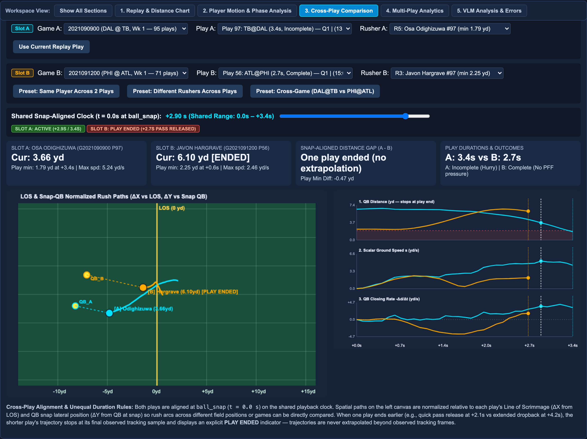

---

### 2.6 Multi-Play & Player-Level Pass-Rush Analytics

The **Multi-Play Analytics** workspace aggregates pass-rush tracking metrics across all loaded games and plays (`166` pass plays, `703` pass-rush snap observations across Games `2021090900` and `2021091200`):

- Interactive filters for **Game**, **Defensive Team**, **Offensive Opponent**, **Down**, **Offensive Formation**, **Pass Outcome**, **PFF Role**, and **Minimum Evaluated Plays**.
- Explicit sample denominators (`Evaluated Plays`) alongside both **Mean** and **Median `[IQR]`** minimum QB distance so small-sample outliers are never disguised behind opaque composite grades.
- Three distribution charts (Top-10 Pass Rusher Box/IQR plot, Time-to-Closest-Approach histogram, and Mean QB Closing Rate histogram) plus an interactive **Play-by-Play Drill-Down** table.

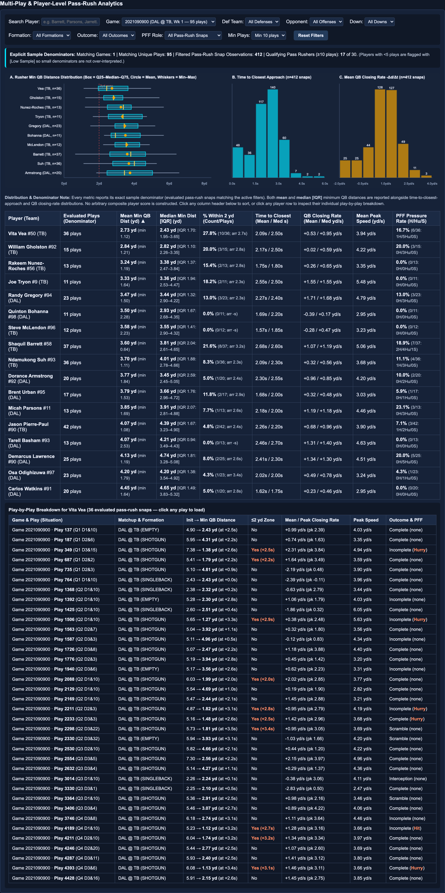

---

### 2.7 VLM Visual Analysis & Tracking-Grounded Error Evaluation

The **VLM Analysis & Errors** workspace displays structured predictions from `Qwen/Qwen2.5-VL-3B-Instruct` alongside independent tracking ground truth, frame-pair distance trends (`F1→F2`, `F2→F3`, `F3→F4`), and an interactive error audit separating **measurable tracking discrepancies** from **hypothesized visual causes**.

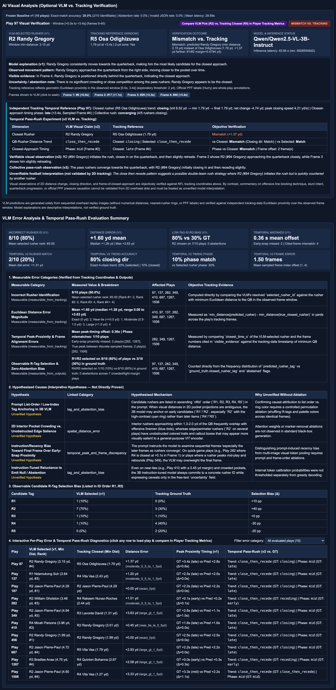

---

## 3. Technical Architecture

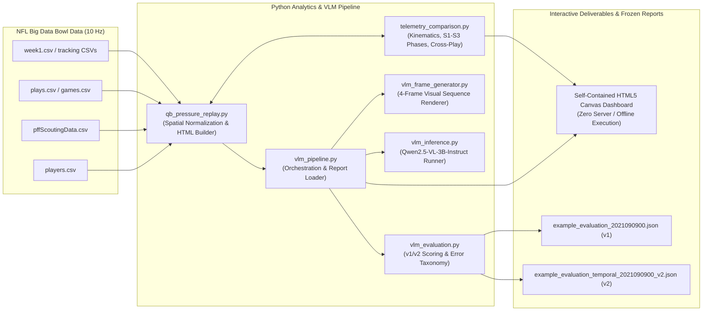

| Module | Responsibility |
| :--- | :--- |
| [`qb_pressure_replay.py`](qb_pressure_replay.py) | Core tracking loader, play-direction orientation, 2.0-yard pressure calculation, PFF scouting alignment, CLI/Tkinter entrypoint, and standalone HTML5 Canvas dashboard generator. |
| [`telemetry_comparison.py`](telemetry_comparison.py) | Per-rusher kinematic series ($d, s, a, \Delta d, -\Delta d/\Delta t$), S1–S3 play-phase decomposition, cross-play/cross-game catalog builder, and multi-play aggregation records. |
| [`vlm_frame_generator.py`](vlm_frame_generator.py) | Deterministic 4-frame visual sequence renderer (`Frame 1 = ball_snap` through `Frame 4 = pass_forward`) with strict anti-leakage filtering (no PFF labels or ground-truth distances shown to the VLM). |
| [`vlm_inference.py`](vlm_inference.py) | Multimodal inference runner for `Qwen/Qwen2.5-VL-3B-Instruct` (`v1` closest-rusher prompt and `v2` temporal pass-rush trajectory prompt) with structured JSON parsing. |
| [`vlm_evaluation.py`](vlm_evaluation.py) | Window-specific tracking ground-truth calculator, `v1` and `v2` temporal trajectory scorer, and tracking-grounded error analysis engine (`analyze_vlm_errors`). |
| [`vlm_pipeline.py`](vlm_pipeline.py) | End-to-end orchestration connecting `qb_pressure_replay.py` with VLM frame generation, inference, and cached evaluation reports (`v1` and `v2`). |
| [`tests/test_vlm_replay.py`](tests/test_vlm_replay.py) | Comprehensive 29-test `pytest` suite covering tracking math, kinematics, phase slicing, cross-play alignment, VLM schema parsing, anti-leakage checks, and generated HTML integrity. |

---

## 4. VLM Visual Analysis & Tracking-Grounded Evaluation

Rather than treating VLM outputs as authoritative commentary, this project uses player-tracking coordinates as an **objective ground-truth oracle** to benchmark what an off-the-shelf 3B Vision-Language Model (`Qwen/Qwen2.5-VL-3B-Instruct`, revision `66285546d2b821cf421d4f5eb2576359d3770cd3`) can and cannot reliably perceive from 4 sequential 2D overhead replay frames (`Frame 1 = ball_snap` through `Frame 4 = pass_forward`).

### 4.1 Frozen Evaluation Summary (Game `2021090900`, `n = 10` Plays)

| Metric | Baseline `v1` ([`example_evaluation_2021090900.json`](example_evaluation_2021090900.json)) | Temporal `v2` ([`example_evaluation_temporal_2021090900_v2.json`](example_evaluation_temporal_2021090900_v2.json)) | Notes |
| :--- | :---: | :---: | :--- |
| **Evaluated Plays** | `10` | `10` | Play IDs `97, 137, 187, 282, 349, 410, 456, 687, 1267, 1506` |
| **Valid Structured JSON Output** | `10 / 10` (`100.0%`) | `10 / 10` (`100.0%`) | `0` abstentions, `0` schema failures |
| **Closest-Rusher Exact Match** | `2 / 10` (`20.0%`) | `2 / 10` (`20.0%`) | Matches on Plays `137` and `687` (`v1`), Plays `137` and `282` (`v2`) |
| **Mean Distance Error (`yd`)** | `1.60 yd` | `1.31 yd` | $\|d_{\text{pred}} - d_{\text{GT}}\|$ at closest approach |
| **Approach Trend Accuracy** | — | `7 / 10` (`70.0%`) | `closing` vs `steady` vs `receding` across frames 1–4 |
| **Closest-Frame Exact Match** | — | `4 / 10` (`40.0%`) | Exact match on which frame (`1..4`) had minimum QB distance |
| **Closest-Frame Within $\pm 1$ Frame** | — | `6 / 10` (`60.0%`) | $\|\hat{f}_{\text{closest}} - f_{\text{closest}}\| \le 1$ |
| **Late-Closing Rusher Recall** | — | `3 / 10` (`30.0%`) | Identifying the rusher with the largest `Frame 3 → Frame 4` drop |
| **Mean Inference Latency (Apple MPS)** | `29.69 s / play` | `29.74 s / play` | Local `Qwen2.5-VL-3B-Instruct` execution |

### 4.2 Key Findings from Tracking-Grounded Error Analysis

1. **Coarse Trend Perception vs. Fine Euclidean Disambiguation:** `Qwen2.5-VL-3B-Instruct` achieves **70.0% accuracy** on coarse temporal movement direction (recognizing that pass rushers are converging toward the pocket across frames 1–4), but achieves only **20.0% exact match** when asked to disambiguate which specific rusher achieved the single smallest Euclidean distance to the QB.
2. **Runner-Up & Close-Competition Misses (Measurable):** Among the 8 misidentified plays in `v1`, **62.5% (`5/8`)** occurred on plays where the true closest rusher beat the second-closest rusher by less than `1.0 yard`, and **50.0% (`4/8`)** of the VLM's false predictions selected the **true 2nd-closest rusher** (e.g., Play `187`, where true closest rusher Vita Vea reached `4.31 yd` and VLM-predicted Ndamukong Suh reached `4.38 yd`, a `0.07 yd` difference).
3. **Early-Salience / Interior Bias (Observed Pattern):** On plays where an interior rusher (`R1`/`R2`) starts closest to the quarterback in Frames 1–2 while an edge rusher (`R4`/`R5`) closes rapidly in Frame 4, the VLM frequently anchors on the early-leading interior defender (predicting `R1` or `R2` on `9/10` plays in `v1` and `8/10` plays in `v2`).

---

## 5. Reproducibility & Quick Start

### 5.1 Environment Setup

```bash
git clone https://github.com/fengzhe-li/nfl-qb-pressure-replay.git
cd nfl-qb-pressure-replay

python3 -m venv .venv
source .venv/bin/activate
pip install -r requirements.txt
```

### 5.2 Dataset Placement

This project uses the **NFL Big Data Bowl 2023** Week 1 tracking and PFF scouting dataset (originally distributed via Kaggle and mirrored for academic/portfolio use at [`ThompsonJamesBliss/nfl-big-data-bowl-regional-event-data`](https://github.com/ThompsonJamesBliss/nfl-big-data-bowl-regional-event-data)). Raw CSV files are excluded from Git via `.gitignore` to respect dataset redistribution norms.

Place the standard CSV files inside `data/` (or in the repository root):

```text
data/
├── games.csv
├── players.csv
├── plays.csv
├── pffScoutingData.csv
└── tracking/
    ├── 2021090900.csv   # or week1.csv in data/
    └── 2021091200.csv
```

### 5.3 Generate the Interactive HTML Dashboard

To generate the standalone HTML dashboard (`qb_pressure_outputs/QB_Replay_2021090900.html`) for Game `2021090900` (Dallas Cowboys @ Tampa Bay Buccaneers, Week 1) along with cross-game comparison data from Game `2021091200` (Philadelphia Eagles @ Atlanta Falcons):

```bash
python qb_pressure_replay.py --id 2021090900 --no-open
```

Open `qb_pressure_outputs/QB_Replay_2021090900.html` in any modern desktop browser (Chrome, Edge, Firefox, or Safari). All interactive animations, 5-track charts, play-phase tables, cross-play comparisons, multi-play filters, and VLM evaluation panels run client-side with zero external server dependencies.

### 5.4 Run Live VLM Inference (Optional — Uses Precomputed Frozen Reports by Default)

The repository includes frozen, tracking-verified evaluation artifacts ([`example_evaluation_2021090900.json`](example_evaluation_2021090900.json) and [`example_evaluation_temporal_2021090900_v2.json`](example_evaluation_temporal_2021090900_v2.json)) that are automatically embedded into the generated dashboard. To run live `Qwen/Qwen2.5-VL-3B-Instruct` visual inference on selected plays locally:

```bash
# Run live VLM inference on up to 10 plays (4 sequential frames/play)
python qb_pressure_replay.py --id 2021090900 --vlm --vlm-max-plays 10 --no-open

# Or target specific play IDs
python qb_pressure_replay.py --id 2021090900 --vlm-plays 97,137,187 --no-open
```

### 5.5 Run Automated Tests

```bash
pytest -v
```

All **29 unit and integration tests** in [`tests/test_vlm_replay.py`](tests/test_vlm_replay.py) verify tracking window slicing, kinematic derivatives, S1–S3 phase partitioning, cross-play alignment without extrapolation, multi-play denominator integrity, VLM error analysis taxonomy, and end-to-end HTML dashboard generation.

---

## 6. Methodological Scope & Limitations

1. **10 Hz Tracking Resolution (`0.1s` Samples):** NFL Next Gen Stats tracking data records player coordinates at 10 frames per second. When **Smooth 60 FPS Visual Interpolation** is enabled in the UI, intermediate canvas positions are linearly interpolated for visual clarity, while all numeric metrics, distance badges, and phase aggregations remain strictly locked to true 10 Hz frames.
2. **Application-Defined 2.0-Yard Proximity Threshold:** The 2.0-yard red dashed threshold is a transparent geometric baseline used to measure close quarterback proximity; it is **not** an official NFL Next Gen Stats or PFF pressure definition.
3. **Geometric Proximity vs. Football Assignment Context:** Euclidean separation $d(t)$ and closing rate $-\Delta d/\Delta t$ measure spatial convergence toward the quarterback. They do not capture offensive line protection calls, double-team absorptions, stunt pick-looper roles, or disciplined edge rushers intentionally holding pocket depth against mobile quarterbacks.
4. **VLM Sample Size & Model Scale:** The VLM evaluation audits `Qwen/Qwen2.5-VL-3B-Instruct` (a 3B general-purpose vision-language model) over a 10-play benchmark using 4 keyframes per play. Fine-grained sub-yard ranking among clustered pass rushers remains challenging for small zero-shot VLMs without specialized spatial tool use or coordinate grounding.

---

## 7. Repository Structure

```text
nfl-qb-pressure-replay/
├── qb_pressure_replay.py                          # Main CLI/GUI application & HTML5 dashboard generator
├── telemetry_comparison.py                        # Kinematics, S1-S3 play phases, cross-play & multi-play engine
├── vlm_frame_generator.py                         # 4-frame sequence renderer with anti-leakage visual formatting
├── vlm_inference.py                               # Qwen/Qwen2.5-VL-3B-Instruct v1 & v2 multimodal inference runner
├── vlm_evaluation.py                              # Tracking ground-truth oracle, v1/v2 evaluator & error analyzer
├── vlm_pipeline.py                                # End-to-end VLM orchestration & cached evaluation report loader
├── example_evaluation_2021090900.json             # Frozen v1 evaluation report (Game 2021090900, 10 plays)
├── example_evaluation_temporal_2021090900_v2.json # Frozen v2 temporal evaluation report (Game 2021090900, 10 plays)
├── requirements.txt                               # Pinned Python dependencies
├── tests/
│   └── test_vlm_replay.py                         # 29 automated pytest unit & integration tests
└── docs/
    └── assets/
        ├── demo/
        │   ├── qb_pressure_replay_hero.gif        # Real recorded hero animation (field + distance + comparison)
        │   ├── cross_play_comparison_demo.gif     # Real recorded cross-game comparison & PLAY ENDED demo
        │   └── qb_pressure_replay_walkthrough.mp4 # Full high-resolution H.264 walkthrough recording
        └── screenshots/
            ├── 01_main_field_replay.png
            ├── 02_smooth_player_comparison.png
            ├── 03_synchronized_tracking_metrics.png
            ├── 04_player_motion_performance_analysis.png
            ├── 05_play_phase_analysis.png
            ├── 06_cross_play_comparison.png
            ├── 07_multi_play_player_analytics.png
            └── 08_vlm_visual_analysis_and_error_evaluation.png
```

---

## 8. Authorship & Acknowledgments

- **Author:** Designed and developed by **Fengzhe Li** ([`@fengzhe-li`](https://github.com/fengzhe-li)), encompassing the original QB Pressure Replay engine, interactive HTML5 Canvas field replay, synchronized multi-track motion analytics, cross-play/cross-game comparison engine, and tracking-grounded VLM evaluation suite.
- **Tracking & Scouting Data:** NFL Next Gen Stats player-tracking data and Pro Football Focus (PFF) scouting data from the **NFL Big Data Bowl 2023** (mirrored for research and portfolio reproducibility via [`ThompsonJamesBliss/nfl-big-data-bowl-regional-event-data`](https://github.com/ThompsonJamesBliss/nfl-big-data-bowl-regional-event-data)).
- **Vision-Language Model:** Multimodal visual inference powered by [`Qwen/Qwen2.5-VL-3B-Instruct`](https://huggingface.co/Qwen/Qwen2.5-VL-3B-Instruct) via Hugging Face `transformers`.
